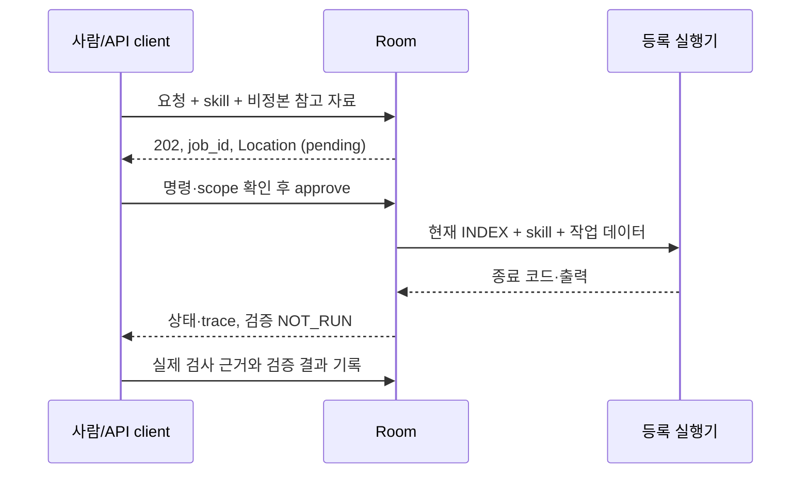

# Agent 엔지니어링: 요구·구현·검증 연결

> **기준 시각:** 2026-10-16 05:36:49 UTC
> **그 뒤 미반영분:** 없음(로컬 구현·fixture/API·브라우저 검증 범위 기준)
> **현행 정본:** `room/server.py`, `room/gitdiff.py`, `room/skills.py`, `room/tracing.py`, `room/evaluate.py`, `room/evals/cases.json`, `room/web/`

공고의 Agent 설계·품질·보안·추적·검증·시연 역량을 실행 경로와 증거에 연결한다. 제품·고객 자료나
개인 경력 정보는 넣지 않으며 현재 구현과 아직 검증하지 않은 영역을 구분한다.

| 요구 | 구현과 근거 | 검증의 한계 |
|---|---|---|
| Agent Harness·Skills | version을 가진 investigate·review-change·implement-change; 역할·mode·승인 재검사 | 룸 workflow이며 개인 Codex/Claude plugin 설치 skill은 아님 |
| Reasoning 활용 | 가설·근거·제약·다음 검증을 산출물로 요구 | 내부 사고를 수집하거나 모델 reasoning 성능을 측정하지 않음 |
| 비동기 API | POST /api/runs → 202·Location → 승인 → GET 상태·trace | 로컬 HTTP·가짜 실행기 실측. 분산 큐·고가용성·고객 부하 검증은 별도 |
| Logging·Tracing | request·approval·execution·verification·recovery span, duration·exit·출력 잘림 | 룸 control plane. provider tool call·token·비용은 미수집 |
| 품질 평가·디버깅 | exit 0과 업무 PASS 분리, 근거 있는 오너 검증, case assertion·duration·baseline | fixture 계약 평가이며 실제 모델 정답률 benchmark는 아님 |
| 권한·Prompt Injection·Guardrail | readonly skill/reviewer, 등록 driver, 비정본 참고 자료, 관찰 token 격리 | 호스트 권한 계약. 실제 모델 Injection 저항률·custom driver OS 격리 보장은 아님 |
| Multi-Agent 협업 | 역할·project-id·승인·수신 예산·프로젝트별 직렬화 | 통제된 협업 기반. 자율 협업 모델 성능은 미측정 |
| 요구→구축→시연 | 요청·승인·실행·검증 분리 API 시나리오 | 합성 fixture 데모이며 고객 실전 경험으로 표현하지 않음 |
| 코드 리뷰·협업 UI | 인용 답글·원문 이동·Git 전후 비교·선택 코드 AI 채팅·후속 문답과 밝기/색상 테마 | 코드 질문도 read-only·별도 승인. 실제 모델 정답률은 미측정 |
| Tool calling·RAG | CLI의 도구 사용과 사람이 제공한 untrusted_references를 분리 | 자체 tool router·자동 검색 RAG는 미구현. 참고 자료 첨부를 RAG로 부르지 않음 |
| Git·컨테이너 | 명시 파일 commit·primary·불변 review 계약 | Git 흐름은 구현됨. 이번 환경에서 Docker daemon 연결 불가; 컨테이너 검증은 별도 |

## 실행·추적·검증 계약



- skill은 기존 권한을 좁힌다. 역할·mode·skill version이 바뀌면 승인 전에 재검사한다. general은 이전
  호출의 호환 경로이며 보안 sandbox가 아니다. 요청이 push·배포·외부 연락 권한을 자동 부여하지 않는다.
- trace_id와 span_id·parent_span_id로 순서를 연결한다. UTC 시각과 monotonic duration을 쓰며 ID는
  사람·project의 정체성을 대신하지 않는다. 요청 원문·참고 자료·출력·경로·이름·검증 근거 본문은
  trace/실행 조회에 넣지 않는다. 오너 상태·전체 transcript에는 로컬 원본이 남으므로 별도 공개 검토한다.
- 종료 code 0은 업무 PASS가 아니다. 기본은 NOT_RUN이고 오너가 근거와 함께 PASS·FAIL·PARTIAL·
  NOT_RUN을 기록한다. verification_source=owner-recorded를 자동 검사와 구분한다. 실패·중단을 PASS로
  바꾸지 않는다. 관찰 token은 실행 조회·trace·검증 기록에 접근할 수 없다.
- 과거 trace 없는 job은 not_collected다. 소급 실행 이력을 만들지 않는다. trace는 로컬 룸 상태의 일부이며
  새 공유 정본·원격 수집 서비스가 아니다. 관측하지 않은 token·비용·tool span을 수치로 만들지 않는다.

## 재현과 회귀

```text
python3 -B -m room.evaluate --output local/evaluations/current.json
python3 -B -m room.evaluate --case api-async-run
python3 -B -m room.evaluate --baseline local/evaluations/current.json --output local/evaluations/next.json
python3 -B -m unittest discover -s room/tests -v
```

실제 loopback HTTP·임시 Git·가짜 프로세스를 사용하며 모델·외부 서비스·개인 계정은 호출하지 않는다.
JSON에는 실제 assertion·case 상태·시나리오 duration·측정 건수·코드와 선택 manifest digest를 담는다.
0건은 NOT_RUN·nonzero이고 실패·잘못된 case·baseline 대상 누락·scenario/검사 항목 변경도 성공으로
집계하지 않는다. 비교 대상 계약을 바꾸면 새 기준을 검토한다. 이 시간은 fixture 소요
시간이며 모델 latency·처리량·고객 효과를 뜻하지 않는다. 회귀 case를 재현한 뒤 원문 대신 ID와 안전한
파일 포인터를 남긴다. 규칙 승격은 [하네스 진화](harness-evolution.md)의 검토·승인 흐름을 따른다.

위 기준 시각의 로컬 확인: 룸 unittest 51개와 fixture 평가 13/13 PASS.
기존 12개에 선택 코드 후속 채팅을 추가했고 manifest 검사를 통과했다. case 집합이 바뀌었으므로 이전
9개·12개 baseline을 새 기준으로 간주하지 않는다. 원본 JSON은 gitignore된
`local/evaluations/code-chat.json`에 두며 공유된 검사 코드로 재실행한다. 이 결과는 코드 계약 검증이며
실제 모델 benchmark가 아니다. 합성 브라우저에서 선택 쪽·클릭/Shift/드래그 범위, 우측 채팅·후속 문답,
건별 승인·가짜 실행기 결과·파일별 초안/선택/대화 복원과 좁은 화면 입력을 확인했다. 기존 답글·테마 검증은
이전 기록에 보존한다. 실제 CLI 모델의 응답 품질·고객 부하·OS sandbox는 이번 검증 범위에 포함하지 않는다.

## 다음 기술의 채택 기준

| 후보 | 착수 증거와 수용 기준 |
|---|---|
| 자동 검색 RAG | 반복 인출 실패·파일 baseline·공개/합성 corpus·정답 근거 ID. 근거 회수·정답·비용·기밀 경계 개선과 fallback을 검증하고 [저장 실행 계약](local-storage-runtime.md)을 따름 |
| provider tool trace | 실제 adapter 이벤트·token·오류·종료 계약. 원문·사고 없이 lineage·실패 전파 재현, 미지원은 미수집 표시 |
| 실제 모델 평가 | 고정 task·checkpoint·기대 artifact·검사기·계정·비용 한도. fixture와 결과 분리, 0건·도구 미실행·비용 초과를 PASS로 표시하지 않음 |
| 컨테이너 실행 | 신뢰한 image·비root·파일/credential 경계·재현 build·smoke test. 실제 build/run·취소 검증 후 지원 대상으로 명시 |

공고만을 이유로 DB·외부 서비스·자율 세션·배포 권한을 추가하지 않는다. 병목·대안·측정·중단 기준을
먼저 정하고 필요한 최소 기능부터 승인된 범위에서 검증한다.
